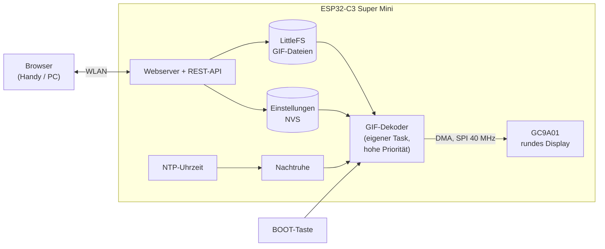
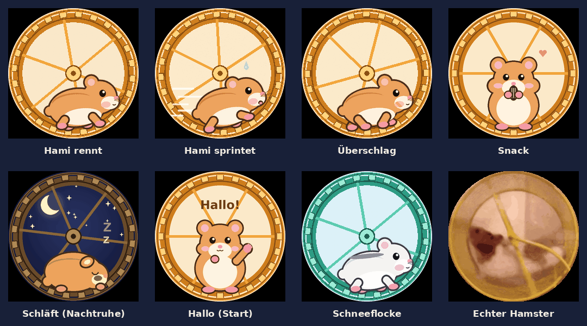
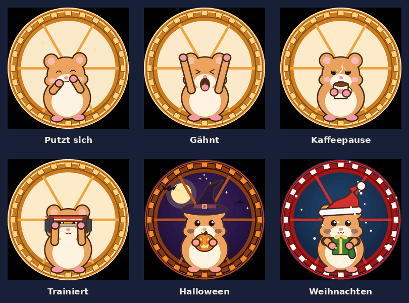
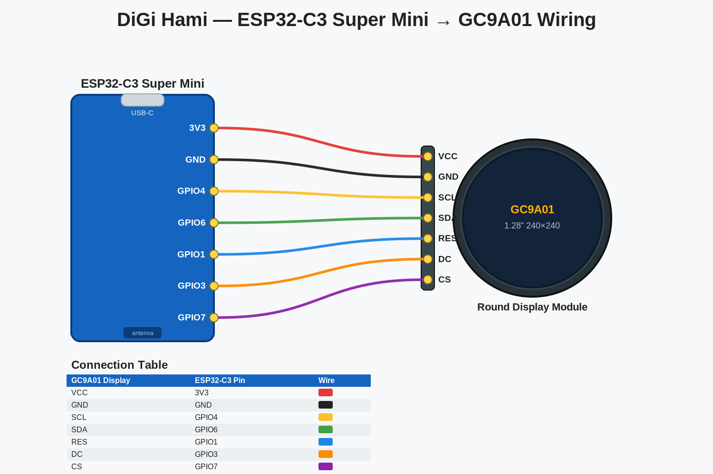
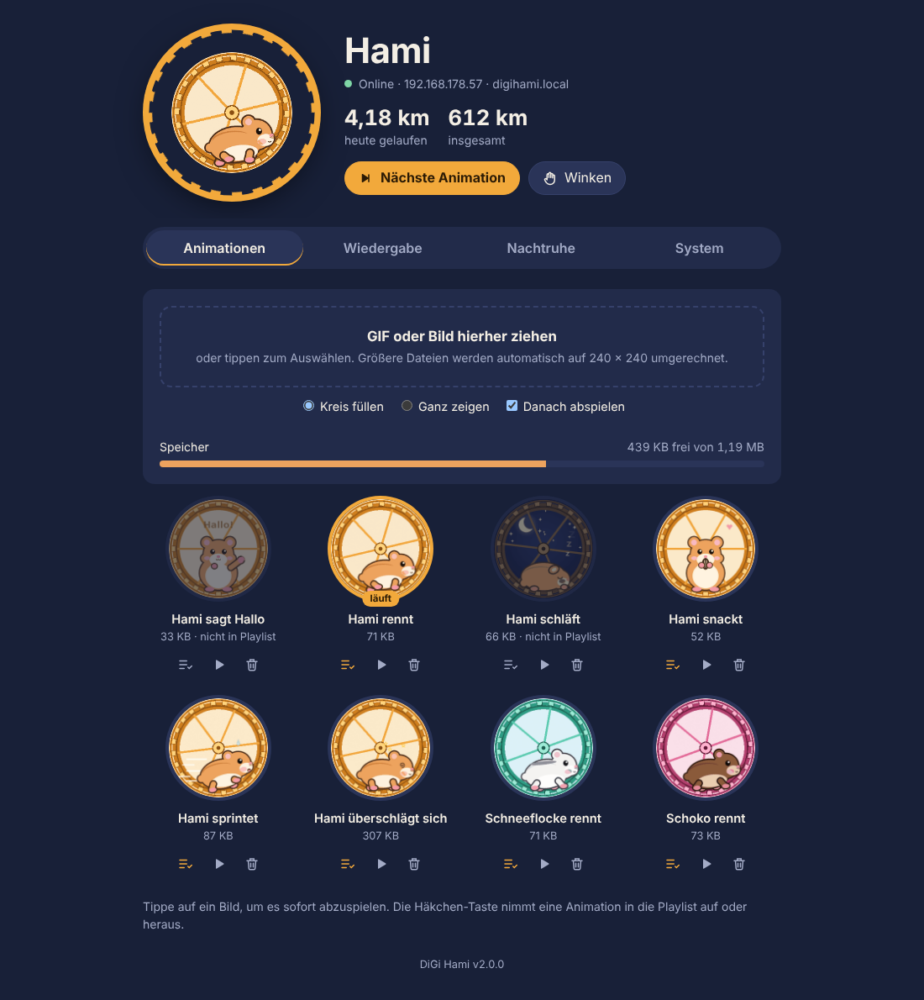
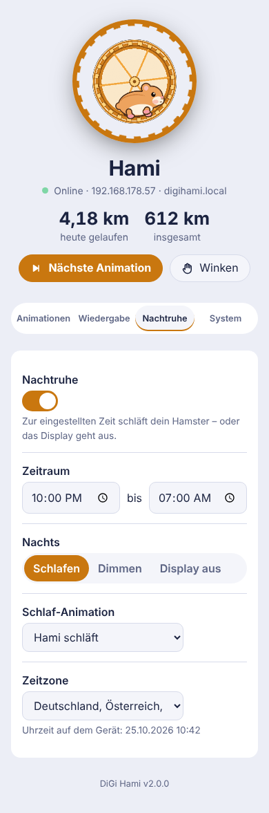

# 🐹 DiGi Hami v2: dein digitaler Schreibtisch-Hamster

![DiGi Hami]

Version 2 ist eine komplett neu geschriebene Firmware für den **ESP32-C3 Super Mini** mit dem runden **1,28″-GC9A01-Display (240 × 240)**. Neu sind eine Web-Oberfläche, die Einrichtung per WLAN und 14 neue Hamster-Animationen.

**Die Verkabelung bleibt gleich wie bei v1.0.** Ein vorhandener DiGi Hami muss also nur neu geflasht werden.

### Schnellstart

1. **Verkabeln:** 7 Kabel zwischen Display und ESP32-C3, siehe [Abschnitt 2](#2-verkabelung).
2. **Flashen:** mit der [Arduino IDE](arduino/ANLEITUNG.md) oder mit [VS Code + pioarduino](#a-vs-code--pioarduino). Ohne Entwicklungsumgebung gehen auch die fertigen Dateien unter [Releases](../../releases) bzw. in `binaries/`.
3. **Einrichten:** QR-Code auf dem Display scannen, WLAN wählen, fertig. Dann erreichst du den Hamster unter **http://digihami.local**.

### Inhalt

| Ordner / Datei | Inhalt |
|---|---|
| [`src/`](src) | Firmware-Quellcode (C++, PlatformIO) |
| [`arduino/DiGi_Hami/`](arduino/DiGi_Hami) | derselbe Code als fertiger Arduino-Sketch, mit allen 14 Animationen ([Anleitung](arduino/ANLEITUNG.md)) |
| [`web/index.html`](web/index.html) | die Web-Oberfläche (wird in die Firmware eingebettet) |
| [`data/gifs/`](data/gifs) | Animationen, die bei PlatformIO aufs Gerät kommen |
| [`extras/`](extras) | weitere Animationen zum Hochladen über die Web-Oberfläche |
| [`binaries/`](binaries) | fertig kompilierte Firmware + Dateisystem für esptool |
| [`tools/`](tools) | Python-Skripte: Animationen zeichnen, Videos umwandeln, Arduino-Sketch erzeugen |
| [`scripts/`](scripts) | Build-Helfer für PlatformIO (Web-UI einbetten, Dateisystem hochladen) |
| [`images/`](images) | Bilder für diese Anleitung |

### So funktioniert's



Der Hamster ist ein ESP32-C3, der GIF-Dateien aus seinem internen Speicher liest, Bild für Bild entpackt und per DMA auf das runde Display schiebt. Das Abspielen läuft in einem eigenen Task mit Vorrang, damit nichts ruckelt, während der Webserver Daten verschickt. Über die Web-Oberfläche lädst du Animationen hoch, stellst die Playlist ein oder schickst den Hamster nachts schlafen.

---

## Was ist neu in v2?

| | v1.0 | v2 |
|---|---|---|
| Animationen | 1 GIF (Video-Hamster) | 7 neue, gezeichnete Animationen + echter Hamster, beliebig erweiterbar |
| Bedienung | keine | Web-Oberfläche im Browser (Handy oder PC) |
| Eigene GIFs | per USB und Neu-Flashen | GIFs, Bilder **und Handyvideos** per Drag-and-drop im Browser, automatisch auf 240 × 240 umgerechnet |
| Wiedergabe | Endlosschleife | eine feste Animation, Playlist der Reihe nach oder zufällig, Tempo, Helligkeit, Drehung |
| Nacht | – | Nachtruhe: Hamster schläft, Display dimmt oder geht aus |
| Updates | nur per USB | zusätzlich Firmware-Update über die Web-Oberfläche |
| Grafik | Adafruit GFX, Zeile für Zeile | LovyanGFX mit DMA, deutlich flüssiger |
| Spielerei | – | Kilometerzähler: wie weit ist dein Hamster heute gelaufen? |

### Die neuen Animationen



| Datei | Inhalt |
|---|---|
| `hami_rennt.gif` | Goldhamster läuft gemütlich im Rad |
| `hami_sprint.gif` | Vollgas: Speed-Linien, Schweißtropfen, angelegte Ohren |
| `hami_ueberschlag.gif` | Zu schnell! Einmal rundherum, kurz benommen, weiter geht's |
| `hami_snack.gif` | Pause mit Sonnenblumenkern, Backentaschen füllen sich |
| `hami_schlaeft.gif` | Eingerollt unterm Mond, Zzz (Standard für die Nachtruhe) |
| `hami_hallo.gif` | Winkt beim Einschalten, während das WLAN verbindet |
| `schneeflocke_rennt.gif` | Weißer Winterhamster im mintgrünen Rad |
| `echter_hamster.gif` | **echter Hamster** im Laufrad (Filmaufnahme aus v1.0, neu aufbereitet für das runde Display) |

Die gezeichneten Animationen sind für das runde Display gemacht: Das Laufrad füllt den Kreis exakt aus und passt damit zum 3D-gedruckten Rad, und die Loops sind nahtlos. Alle 8 zusammen belegen ~930 KB. Für eigene GIFs bleiben ~430 KB frei (PlatformIO) bzw. ~970 KB (Arduino IDE mit „No OTA“).

### Noch mehr Hami



| Datei | Inhalt |
|---|---|
| `hami_putzt.gif` | putzt sich mit den Pfötchen das Gesicht |
| `hami_gaehnt.gif` | gähnt herzhaft und streckt sich |
| `hami_kaffee.gif` | Kaffeepause: verschlafen, ein Schluck, hellwach |
| `hami_hantel.gif` | Fitness mit Hantel und Stirnband |
| `hami_halloween.gif` | Hexenhut, leuchtender Kürbis, Fledermäuse |
| `hami_weihnachten.gif` | Weihnachtsmütze, Schal, Geschenk, Schnee |

Sie liegen in `extras/mehr/`. Bei der **Arduino-IDE-Variante** sind sie schon im Sketch-Ordner enthalten und landen beim Dateisystem-Upload automatisch auf dem Board, zusammen mit den 8 anderen. Bei **PlatformIO** reicht der Speicher nicht für alle 14 gleichzeitig; lade dort die gewünschten über die Web-Oberfläche hoch.

**Extras** (über die Web-Oberfläche hochladen, wenn du sie willst):
- `extras/echter_hamster_fluessig.gif`: der echte Hamster mit voller Bildrate (14 statt 7 fps, 430 KB). Vorher z. B. den Überschlag löschen, damit genug Platz ist.
- `extras/schoko_rennt.gif`: Schoko-Hamster im Beeren-Rad

### Deinen eigenen Hamster aufs Display bringen

Film deinen Hamster im Laufrad mit dem Handy, möglichst ruhig und von der Seite, und lade das Video in der Web-Oberfläche hoch (Tab *Animationen*). Der Browser schneidet es rund zu, rechnet es auf 240 × 240 um und komprimiert es so stark wie nötig, damit es in den freien Speicher passt: erst mit 12 fps, notfalls mit 8 oder 6. Mit „ab … s“ und „Länge … s“ wählst du den Ausschnitt; 2–3 Sekunden genügen für einen schönen Loop. MP4 vom Handy funktioniert in Chrome, Edge und Safari.

Am PC geht das auch mit `tools/convert_real.py` (braucht ffmpeg):

```bash
python3 tools/convert_real.py mein_hamster.mp4 data/gifs/mein_hamster.gif --start 2 --len 3 --zoom 1.3
```

---

## 1. Benötigte Teile

Unverändert gegenüber v1.0:

| # | Teil | Hinweis |
|---|---|---|
| 1 | 3D-Druckteile | [MakerWorld-Projekt](https://makerworld.com/en/models/3096322-digi-hami-your-digital-desk-hamster-companion) |
| 2 | ESP32-C3 Super Mini | am besten mit **vorgelöteten** Stiftleisten |
| 3 | GC9A01 1,28″ rund, 240 × 240, SPI | Variante „1.28 TFT Round“ |
| 4 | 7 Dupont-Kabel, Buchse–Buchse, 10 cm | |
| 5 | USB-C-Kabel (Daten, nicht nur Laden) | |
| 6 | Einstreu + Kleber | für die Optik |

Optional: ein 8. Kabel von **BLK** an **GPIO10** für echtes Dimmen der Hintergrundbeleuchtung (siehe [Abschnitt 7](#7-optionen-für-bastler)).

---

## 2. Verkabelung



| GC9A01 | ESP32-C3 Super Mini | Funktion |
|:---:|:---:|---|
| VCC | 3V3 | Versorgung 3,3 V (**nicht 5 V!**) |
| GND | GND | Masse |
| SCL | GPIO4 | SPI-Takt |
| SDA | GPIO6 | SPI-Daten |
| RES | GPIO1 | Reset |
| DC | GPIO3 | Daten/Befehl |
| CS | GPIO7 | Chip Select |
| BLK | nicht verbunden (oder 3V3) | Hintergrundbeleuchtung |

GPIO2, GPIO8 und GPIO9 sind Strapping-Pins des C3 und werden für das Display bewusst nicht benutzt. GPIO9 ist die **BOOT-Taste** auf der Platine; v2 nutzt sie im Betrieb als Bedienknopf.

---

## 3. Flashen

Du hast drei Möglichkeiten:

| Weg | Für wen | Anleitung |
|---|---|---|
| **A: VS Code + pioarduino** | ein Klick erledigt alles, Firmware-Updates auch per WLAN | gleich hier unten |
| **B: Arduino IDE** | wenn du die Arduino IDE schon nutzt | **[arduino/ANLEITUNG.md](arduino/ANLEITUNG.md)**; der fertige Sketch liegt in `arduino/DiGi_Hami/` |
| **C: fertige Dateien** | ohne Entwicklungsumgebung, nur esptool oder Browser | [`binaries/LIESMICH.txt`](binaries/LIESMICH.txt) bzw. die Downloads unter [Releases](../../releases) |

### A: VS Code + pioarduino

Wie bei v1.0 (die Bebilderung aus der v1-Anleitung gilt unverändert):

1. VS Code installieren, Erweiterung **pioarduino IDE** installieren (die klassische „PlatformIO IDE“ vorher deaktivieren).
2. Das Repository herunterladen (grüner Button **Code → Download ZIP**, oder `git clone`), entpacken und in VS Code **Datei → Ordner öffnen…** wählen. Beim ersten Öffnen lädt pioarduino die Plattform und die drei Bibliotheken herunter (LovyanGFX, AnimatedGIF, ArduinoJson). Das dauert ein paar Minuten.
3. ESP32-C3 per USB-C anschließen.
4. Oben auf **→ Upload** klicken. Das erledigt alles in einem Rutsch:
   1. Web-Oberfläche in die Firmware einbetten (`scripts/embed_web.py`)
   2. Firmware kompilieren und flashen
   3. Animationen aus `data/gifs/` als Dateisystem hochladen (`scripts/upload_fs.py`)
5. Beide Schritte müssen mit `SUCCESS` enden.

> ⚠️ **Wichtig:** Der automatische Dateisystem-Upload ersetzt **alle** GIFs auf dem Gerät, auch die per Browser hochgeladenen. Für spätere Firmware-Updates nimm deshalb lieber das Update über die Web-Oberfläche (System → Firmware-Update). Dabei bleiben deine GIFs erhalten.

Falls nur das Dateisystem fehlt (Display zeigt „Keine Animation“): pioarduino-Seitenleiste → **Project Tasks → esp32-c3-supermini → Platform → Upload Filesystem Image**.

**Bootloader erzwingen**, falls der Upload nicht klappt: BOOT halten, RESET kurz drücken, BOOT loslassen, dann erneut hochladen.

---

## 4. Ersteinrichtung (WLAN)

1. Nach dem ersten Start zeigt das Display **„WLAN einrichten“** und einen **QR-Code**.
2. QR-Code mit dem Handy scannen, oder von Hand mit dem offenen WLAN **`DiGi-Hami-XXXX`** verbinden.
3. Die Einrichtungsseite öffnet sich automatisch (Captive Portal). Falls nicht, im Browser **http://192.168.4.1** aufrufen.
4. Unter **System → WLAN** auf *Netzwerke suchen* tippen, dein WLAN wählen, Passwort eingeben, *Verbinden und neu starten*.
5. Nach dem Neustart winkt der Hamster, verbindet sich und zeigt kurz seine **IP-Adresse** samt QR-Code. Ab jetzt erreichst du ihn unter:
   - **http://digihami.local** (Name änderbar unter System), oder
   - der angezeigten IP-Adresse, z. B. `http://192.168.178.57`

Findet der Hamster dein WLAN später einmal nicht, öffnet er automatisch wieder den Einrichtungs-Hotspot und versucht es im Hintergrund jede Minute erneut.

---

## 5. Die Web-Oberfläche



Oben siehst du live, was gerade auf dem Display läuft, dazu den Kilometerzähler und die Knöpfe *Nächste Animation* und *Winken* (zeigt Name und IP kurz auf dem Display, praktisch zum Wiederfinden).

**Animationen**
- GIFs, PNGs, JPGs, WebPs oder **Videos** (MP4, MOV, WebM) ins Feld ziehen bzw. antippen. Alles, was größer als 240 × 240 ist, wird **direkt im Browser umgerechnet** (Chrome und Edge können auch animierte GIFs umrechnen). Dabei hast du die Wahl zwischen „Kreis füllen“ und „Ganz zeigen“.
- Auf ein Bild tippen spielt es sofort ab.
- Mit der Häkchen-Taste nimmst du eine Animation in die Playlist auf oder heraus. Schlafen und Hallo sind anfangs nicht in der Playlist.
- Der Speicherbalken zeigt, wie viel Platz noch frei ist.

**Wiedergabe:** *Nur eine*, *Der Reihe nach* oder *Zufällig*. Dazu der Wechsel-Takt in Minuten (gewechselt wird immer am Ende eines Durchlaufs), das Tempo (25–300 %), die Helligkeit und die Drehung (0/90/180/270°, falls das Display schief im Rad sitzt).

**Nachtruhe:** Zeitraum (z. B. 22:00 bis 07:00) und was nachts passiert: *Schlafen* (Schlaf-Animation), *Dimmen* oder *Display aus*. Braucht WLAN mit Internet, weil die Uhrzeit per NTP geholt wird. Startest du nachts von Hand eine Animation, hat das Vorrang bis zum Ende der Nachtruhe.

**System:** Name des Hamsters, Netzwerkname (`xyz.local`), WLAN, Firmware-Update, Neustart, Werkseinstellungen (die GIFs bleiben dabei erhalten) und Geräte-Infos wie RAM, Bildrate und Speicher.



### BOOT-Taste

| Drücken | Wirkung |
|---|---|
| kurz | nächste Animation |
| 2 Sekunden | Info-Bildschirm mit IP-Adresse und QR-Code |
| 10 Sekunden | WLAN-Zugangsdaten löschen und Neustart in den Einrichtungsmodus |

---

## 6. Eigene Animationen

**Am einfachsten:** über die Web-Oberfläche hochladen. Die Umrechnung passiert automatisch.

**Per USB:** GIFs in `data/gifs/` legen und *Upload Filesystem Image* ausführen. Regeln:
- maximal **240 × 240** Pixel. Größere Dateien werden vom Gerät abgelehnt; die Web-Oberfläche rechnet sie automatisch um.
- Dateinamen in Kleinbuchstaben ohne Leerzeichen, z. B. `mein_hamster.gif`
- Dateien mit „schlaf“, „sleep“, „snack“ oder „hallo“ im Namen zählen nicht zum Kilometerzähler

**Neue Hamster zeichnen lassen:** Alle gezeichneten Animationen werden von `tools/make_gifs.py` erzeugt, ganz ohne fertige Grafiken. Farben, Fellmuster und Radfarbe sind oben im Skript als Themen definiert (`FUR_GOLD`, `WHEEL_MINT`, …). Ein neuer Hamster ist eine Zeile in `SCENES`:

```bash
pip install pillow numpy
python3 tools/make_gifs.py              # alle neu erzeugen
python3 tools/make_gifs.py run sleep    # nur bestimmte
```

Ist `gifsicle` installiert, werden die Dateien zusätzlich verkleinert.

---

## 7. Optionen für Bastler

Einstellbar in `platformio.ini` unter `build_flags` (Details in `src/config.h`):

| Flag | Wirkung |
|---|---|
| `-DTFT_BL=10` | BLK-Pin an GPIO10 → echte Helligkeitsregelung per PWM statt Software-Dimmen |
| `-DTFT_SPI_HZ=80000000` | 80 MHz SPI: flüssiger, braucht aber kurze, saubere Leitungen (Standard 40 MHz) |
| `-DTFT_INVERT=0` / `-DTFT_BGR=1` | falls Farben invertiert oder Rot/Blau vertauscht sind |
| `-DWIFI_TX_POWER=WIFI_POWER_15dBm` | höhere Sendeleistung (Standard 8,5 dBm, siehe Fehlerbehebung) |
| `-DHAMI_NO_TURBO` | Turbo-Dekoder nie benutzen (spart RAM) |

---

## 8. Fehlerbehebung

| Problem | Lösung |
|---|---|
| Display bleibt schwarz, Upload ok | Verkabelung prüfen; bei manchen Modulen **BLK → 3V3** verbinden |
| „Keine Animation“ auf dem Display | Dateisystem fehlt → *Upload Filesystem Image*, oder GIFs per Web-Oberfläche hochladen |
| Farben falsch (Negativ / Rot-Blau vertauscht) | `-DTFT_INVERT=0` bzw. `-DTFT_BGR=1` setzen |
| Bildstörungen / Flackern | Kabel kürzer oder fester stecken; `TFT_SPI_HZ` nicht über 40 MHz |
| Animation ruckelt | Unter *System → Gerät* stehen Bildrate und ms/Frame. Liegen die ms/Frame über der GIF-Framedauer (~50 ms), ist der Dekoder am Limit: `TFT_SPI_HZ` auf 80 MHz (kurze Kabel), oder im Tab *Wiedergabe* das Tempo senken |
| Web-Oberfläche lädt langsam | Beim ersten Aufruf lädt der Browser die Vorschaubilder einmalig, danach kommen sie aus dem Cache. Bei schwachem Signal unter *System → WLAN → Sendeleistung* eine höhere Stufe wählen |
| WLAN verbindet nicht | Die C3 Super Mini hat eine schwache Antenne; die Firmware nutzt deshalb 8,5 dBm. 2,4-GHz-Netz prüfen (5 GHz geht nicht), näher an den Router |
| `digihami.local` geht nicht | Manche Android-Geräte kennen kein mDNS → IP-Adresse nutzen (BOOT 2 s drücken zeigt sie an) |
| Nachtruhe greift nicht | Braucht Internet für die Uhrzeit; im Tab Nachtruhe steht die Gerätezeit |
| GIF wird abgelehnt | größer als 240 × 240 → über die Web-Oberfläche hochladen, die rechnet es um |
| Kein Serial-Log | `ARDUINO_USB_CDC_ON_BOOT=1` ist gesetzt; Serial Monitor mit 115200 Baud öffnen |

---

## 9. Technische Notizen

- **Speicher (4 MB Flash):** PlatformIO nutzt die Standardpartitionen (2 × 1,25 MB App für OTA-Updates + 1,375 MB LittleFS); die Firmware belegt dort ~1,26 MB. Die Arduino IDE nutzt „No OTA“ (2 MB App + 1,9 MB LittleFS), weil die Firmware mit dem Arduino-Core etwas größer ist (~1,30 MB).
- **Gleicher Code für beide:** `tools/make_arduino.py` erzeugt den Arduino-Sketch aus `src/`.
- **Wiedergabe:** AnimatedGIF im „cooked“-Modus mit 8-Bit-Framepuffer. Die fertigen Zeilen werden zu 16-Zeilen-Streifen gesammelt und per **DMA** zum Display geschoben (Doppelpuffer). Teil-Frames, Transparenz und Disposal werden korrekt behandelt.
- **AnimatedGIF-Fehler umgangen:** In Version 2.2.0 liefert der RGB565-„cooked“-Pfad an transparenten Stellen ungültige Pixel. Die Firmware liest die Zeilen deshalb selbst aus dem Framepuffer. GIFs mit **eigener Farbpalette pro Frame** (häufig bei aus Videos erzeugten GIFs) laufen automatisch über einen zweiten Zeichenpfad, der nur deckende Pixel direkt aufs Display schreibt. Beide Pfade wurden gegen eine Referenz-Dekodierung Frame für Frame pixelgenau getestet.
- **Web-Oberfläche:** eine einzige HTML-Datei (`web/index.html`), die beim Build gzip-komprimiert (~15 KB) in die Firmware eingebettet wird. Sie funktioniert komplett offline, auch im Einrichtungs-Hotspot. GIF-Umrechnung und LZW-Kodierung laufen im Browser.
- **Automatischer Build:** Bei jedem Push baut eine GitHub Action ([`.github/workflows/build.yml`](.github/workflows/build.yml)) die PlatformIO-Firmware und den Arduino-Sketch. Bei einem Versions-Tag (`v2.0.1` …) hängt sie Firmware und Dateisystem-Image automatisch als Release an.
- **REST-API** (für eigene Skripte oder Home Assistant): `GET /api/status`, `GET /api/files`, `GET|POST /api/settings`, `POST /api/play?name=…`, `POST /api/next`, `POST /api/delete?name=…`, `POST /api/upload` (multipart), `POST /api/update` (Firmware), `POST /api/identify`, `POST /api/reboot`.

---

## Lizenz und Dank

Danke an [deadpoh](https://www.instagram.com/_deadpohl_/) und [jknoepfel](https://github.com/jeremyknoepfel/hamster-wheel) für das ursprüngliche Design, und an IdefixRC für DiGi Hami v1.0 und das verbesserte 3D-Modell.

Firmware-Bibliotheken: **LovyanGFX** (lovyan03), **AnimatedGIF** (bitbank2), **ArduinoJson** (bblanchon). Lizenz siehe `LICENSE`.

**Kein Füttern. 24/7 aktiv. Null Wartung. Unendlich flauschig.** 🐹
